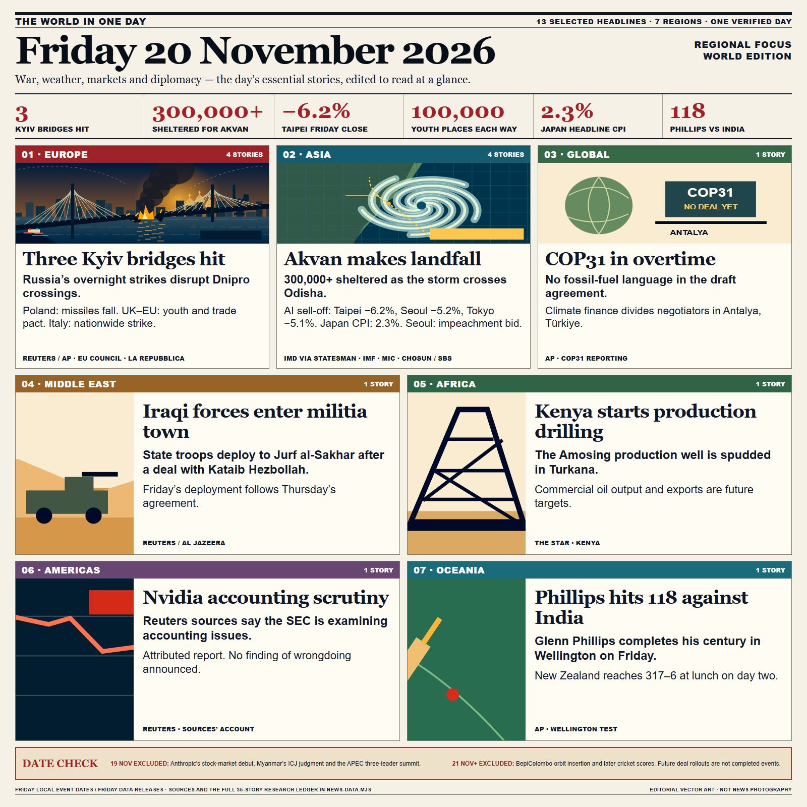

# The World in One Day — Friday 20 November 2026

An original world-news image built from a 35-story verified research ledger across seven regions. The design configuration selects either the detailed broadsheet or a more selective regional layout. The regional design presents 13 selected headlines in seven larger illustrated panels to improve thumbnail readability. Every selected event retains its source and date basis in the full ledger.



## Images and entrypoint

- `front-page.png`: the 1600 × 1600 master.
- `submission.png`: the 1024 × 1024 contest image, below 1 MiB.
- `main.ts`: Node 22 entrypoint. With no dependencies or network, writes the submission bytes to `/output/entry.png`.

For a local run, set `MAKEFUN_OUTPUT_DIR` to a writable folder, then run `node main.ts`. The high-resolution master is deliberately separate because the contest caps the output image at 1024 pixels per side.

## Regenerate

Install Node, Microsoft Edge and Python with Pillow, then run:

```sh
npm install
python -m pip install Pillow
npm run build
```

For another Chromium installation, set `CHROMIUM_EXECUTABLE` to its absolute executable path. The build checks actual text rectangles, container boundaries, SVG labels, map-label separation, story counts, image dimensions, byte size and two repeated entrypoint runs. These checks run on both the 1600px master and the native 1024px CSS layout. The contest image is rendered with deviceScaleFactor 2, then downsampled once with Lanczos. The build stops on text collisions or clipping instead of silently cropping text.

`build-broadsheet.mjs` creates the HTML from `news-data.mjs` and the original SVG scenes in `broadsheet-art.mjs`. `render-broadsheet.mjs` creates both PNGs and the machine-readable layout report. Only rendering uses Playwright and Pillow; the judged entrypoint uses the Node standard library alone.

`design-config.json` selects the current readability treatment in `readability-editions.mjs`. The shortened display copy retains the original facts, including claim attribution and future rollout qualifications; the complete source record remains in `news-data.mjs`.

## Date and source policy

`news-data.mjs` links a named reporting source for every story and records whether the date belongs to the event, a data release or a first report. `date-audit.json` contains the full source ledger, additional evidence, timeline basis and exclusions. Local event dates govern the edition. October inflation and quarterly crime figures are identified as data released on Friday rather than events measured on that day.

The date-check strip excludes Thursday's Anthropic stock-market debut, the Myanmar ICJ judgment, the APEC three-leader summit and the US cyber-chief departure. It also excludes Saturday's BepiColombo orbit insertion and later cricket scores. The Friday close of Anthropic's offering is a separate event and was omitted to avoid ambiguity.

The UK–EU figure means 100,000 future youth places in each direction under the agreement; it is not 100,000 visas issued on Friday. Nvidia's accounting investigation is attributed to Reuters sources, with no finding asserted and no unverified percentage loss printed. Akvan's local landfall time is approximate; the UTC timeline shows the reported crossing interval.

Reporting includes AP, Reuters, IMD as relayed by Indian reporting, the European Council, IMF's November 20 Global Markets Monitor, SBS, Chosun, The Star, Sudan Tribune, Africanews, UNICEF, WHO and the Federal Reserve. CONFIRMED means the stated event or report is documented, not that every allegation within it is independently proven. CLAIM preserves the claimant's attribution.

## Map and license

`world-land.json` is public-domain Natural Earth 1:110m land geometry, downloaded from the Natural Earth project's `nvkelso/natural-earth-vector` repository. Numbered labels can move for readability; leader lines retain their true longitude and latitude anchors. All drawings are editorial schematics, not news photographs or assertions of exact physical damage geometry.

Code and original illustrations: MIT. Built for the [make.fun November 20 news-image bounty](https://make.fun/bounty/news-image-20261120).
